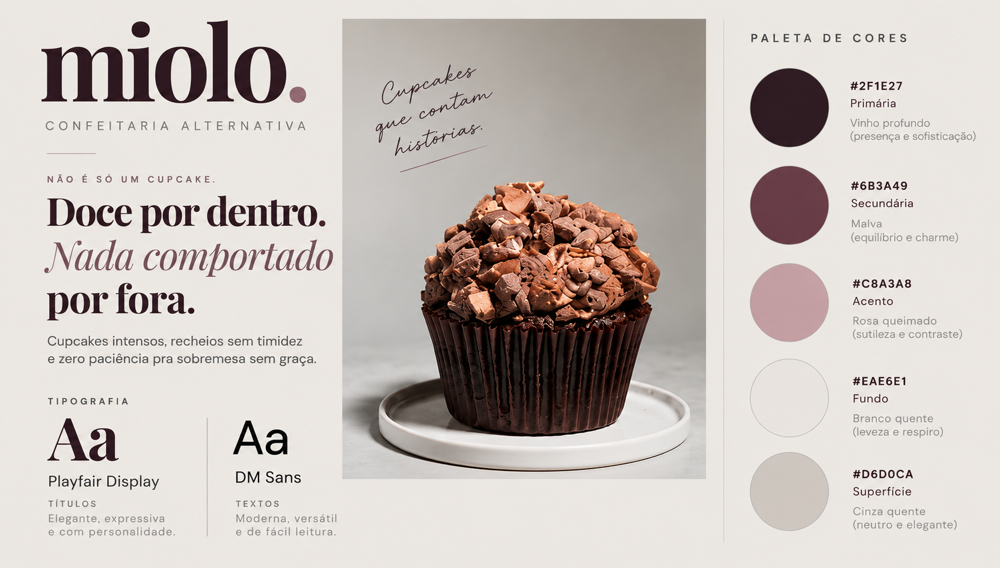

# Miolo


<p align="center">
  
  
  
</p>

<p align="center">
  
  
  
  
  
</p>


A **Miolo** é um projeto de confeitaria alternativa desenvolvido como parte das atividades acadêmicas da disciplina de Projeto Integrador Transdisciplinar (PIT).

A proposta foi criar uma aplicação web que simulasse uma loja virtual de cupcakes, permitindo que o usuário navegasse pelos produtos, adicionasse itens ao carrinho, criasse uma conta e registrasse pedidos.

Além de desenvolver a interface, quis trabalhar com algumas funcionalidades que aproximassem o projeto de uma aplicação real, principalmente a autenticação de usuários e o armazenamento de informações em banco de dados.


<p align="center">
  <a href="https://eliza-wollinger.github.io/miolo/">
    
  </a>
</p>


## Sobre o projeto

A Miolo foi pensada como uma confeitaria com uma identidade visual própria, fugindo um pouco da estética tradicional de lojas de doces.

Optei por uma combinação de cores mais neutras, com detalhes em tons de vinho, e uma apresentação mais simples dos produtos.

Durante o desenvolvimento, procurei manter a navegação intuitiva e organizar o código de forma que fosse possível adicionar novas funcionalidades sem precisar reconstruir o projeto inteiro.



## Funcionalidades

Atualmente, o projeto conta com:

- Catálogo de cupcakes carregado a partir do banco de dados;
- Filtragem de produtos por categoria;
- Carrinho de compras com ajuste de quantidades e cálculo automático do total;
- Armazenamento local do carrinho para preservar os itens durante a navegação;
- Cadastro e login utilizando e-mail e senha;
- Autenticação com conta Google;
- Registro de pedidos demonstrativos no banco de dados;
- Histórico de pedidos associado à conta do usuário;
- Exibição da data, dos produtos, do valor total e do status de cada pedido;
- Interface adaptada para diferentes tamanhos de tela.

Os pedidos ficam vinculados ao usuário autenticado. Dessa forma, ao sair e entrar novamente na conta, é possível consultar o histórico de compras anteriores.

## Tecnologias utilizadas

O projeto foi desenvolvido utilizando:

- **HTML5:** estrutura das páginas;
- **CSS3:** estilização, identidade visual e responsividade;
- **JavaScript:** navegação, filtros, carrinho e integração entre os componentes;
- **Firebase Authentication:** cadastro e autenticação dos usuários;
- **Cloud Firestore:** armazenamento dos produtos e pedidos;
- **Git e GitHub:** versionamento e organização do código;
- **GitHub Pages:** publicação da aplicação.

Optei por utilizar HTML, CSS e JavaScript sem frameworks para trabalhar diretamente com os conceitos fundamentais do desenvolvimento web.

## Como funciona

### Catálogo e carrinho

Os produtos são cadastrados no Cloud Firestore e carregados pela aplicação.

O usuário pode visualizar os cupcakes disponíveis, filtrar por categoria e adicionar os produtos ao carrinho. Os valores são calculados automaticamente conforme a quantidade selecionada.

O carrinho utiliza o armazenamento local do navegador para manter os itens mesmo quando a página é atualizada.

### Autenticação

Para finalizar um pedido, é necessário estar autenticado.

O sistema utiliza o Firebase Authentication, permitindo cadastro com e-mail e senha ou acesso por uma conta Google.

### Pedidos

Ao finalizar uma compra demonstrativa, a aplicação registra um documento na coleção de pedidos do Cloud Firestore.

Esse registro contém as informações dos produtos, quantidades, valores, status e identificação do usuário responsável.

Na área **Minha conta**, o usuário consegue consultar os pedidos anteriores, organizados do mais recente para o mais antigo.

Os testes realizados incluíram a criação de diferentes pedidos e a verificação da permanência do histórico após sair e entrar novamente na conta.

## Estrutura do projeto

A aplicação foi organizada separando a estrutura das páginas, a estilização e as funcionalidades JavaScript.

```text
miolo/
├── index.html
├── css/
│   └── style.css
├── js/
│   ├── app.js
│   ├── auth.js
│   └── firebase-config.js
├── assets/
│   ├── branding/
│   └── images/
└── README.md
```

Os principais arquivos são:

- `index.html`: estrutura da aplicação;
- `css/style.css`: estilos e responsividade;
- `js/app.js`: catálogo, filtros, carrinho e finalização de pedidos;
- `js/auth.js`: autenticação e histórico de pedidos;
- `js/firebase-config.js`: configuração de conexão com o Firebase.

## Acessar o projeto

A aplicação está publicada no GitHub Pages:

**[Miolo — Confeitaria Alternativa](https://eliza-wollinger.github.io/miolo/)**

Para executar o projeto localmente, é possível clonar o repositório e abrir a aplicação utilizando um servidor local, como a extensão Live Server do VS Code.

A aplicação depende de uma conexão com a internet para acessar os serviços do Firebase.

## Limitações

A Miolo é um **protótipo acadêmico** e não realiza vendas ou pagamentos reais.

O processo de finalização simula o registro de uma compra, mas não possui integração com meios de pagamento, controle de estoque em tempo real ou processamento de entregas.

Os preços e totais são calculados no navegador. Para uma aplicação comercial, seria necessário implementar validações adicionais no servidor, além de uma integração segura com um serviço de pagamentos.

## Considerações finais

O desenvolvimento da Miolo permitiu trabalhar diferentes partes de uma aplicação web, desde a construção da interface até a integração com serviços externos.

Uma das partes mais interessantes foi conectar o carrinho de compras à autenticação e ao banco de dados, permitindo que os pedidos fossem registrados e posteriormente consultados pelo usuário.

Também foi uma oportunidade para praticar organização de código, tratamento de erros, testes e versionamento com GitHub.

O projeto ainda pode ser expandido com novas funcionalidades, mas a versão atual já permite demonstrar o fluxo principal de uma loja virtual, desde a escolha dos produtos até o acompanhamento dos pedidos.

---
